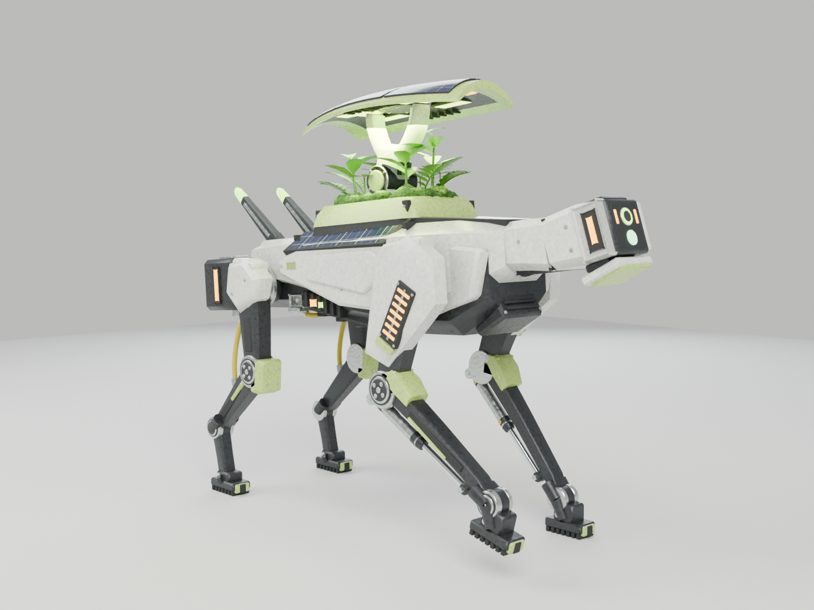
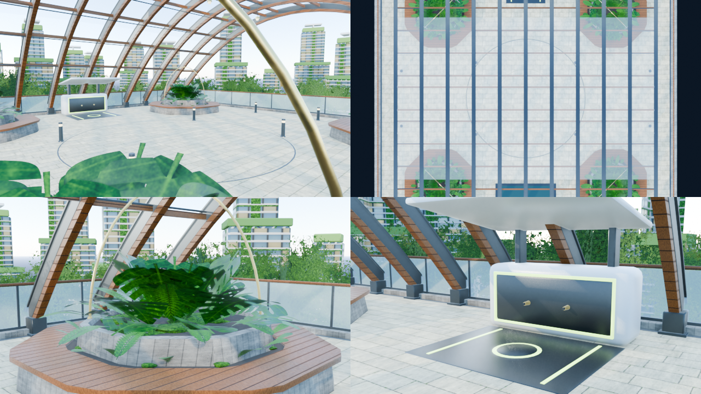
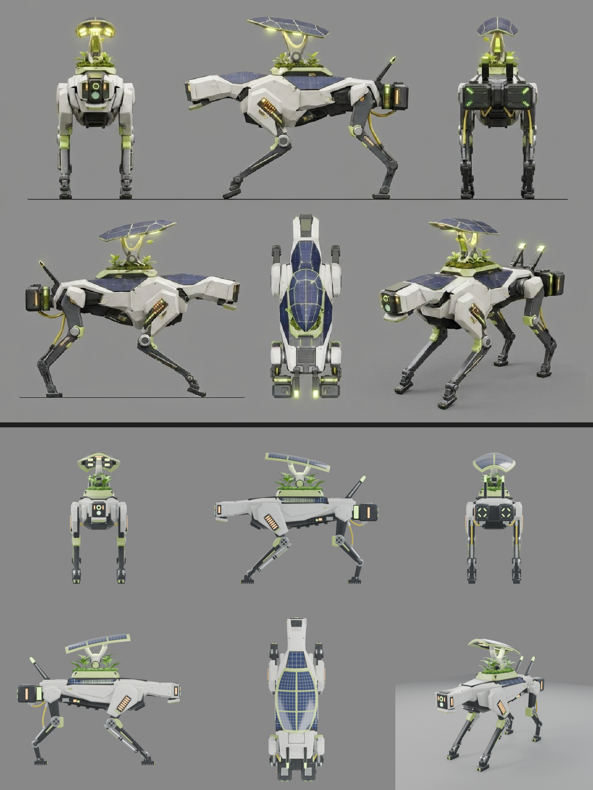

# FLORA-01 — Autonomous Botanical Quadruped & Rooftop Conservatory

> **Live Interactive 3D Demo:** **[https://abinanthan-cg.github.io/flora-01/](https://abinanthan-cg.github.io/flora-01/)**

**FLORA-01** is a fully rigged, analytically animated solarpunk botanical quadruped and playable rooftop botanical conservatory built 100% programmatically in **Python + Blender 5.2**, following the reference-first [AnyMachine](https://github.com/apekshik/anymachine) hard-surface pipeline and deployed as a zero-build Three.js interactive robotics console.



---

## Interactive Controls (Live Demo)

| Input | Action |
|---|---|
| **`W` / `S`** | Walk forward / walk backward (reverse-throttle locked) |
| **`A` / `D`** | Analytical 3D abduction pivot turn (in-place) or curved-turn steering while moving |
| **`Shift` + `W`** | Trot gait (forward only) |
| **`E`** | Inspect Bow — press near any of the 4 pulsing conservatory planter beds to mist & bloom it (`BIOME 0/4`) |
| **`Space`** | Sun Salute stretch |
| **`H`** | Toggle **Hide UI / Cinema View** for clean full-screen exploration & screenshots |
| **Mouse** | Drag to orbit · Scroll to zoom · Click any of the 80 robot parts to inspect its bone, triangle count & role |

---

## Verified Engineering Specs

| Metric | FLORA-01 (`flora_quad`) | Conservatory World (`courtyard_env`) |
|---|---|---|
| **Geometry** | 80 articulated parts · 55,770 tris · 0 n-gons | 16 architectural meshes · 52,078 tris · 0 n-gons |
| **Real-World Scale** | `1.253 × 0.439 × 1.009 m` (Spot-class) | `18.0 × 18.0 m` flat `Z = 0.000 m` walkable terrace |
| **Rig & Kinematics** | 30 bones · 8 analytical 3D IK actions · `0.0001 mm` hydraulic aim error (`37.8 mm` stroke) | 14 smooth colliders + 4 interactive botanical care stations + solar dock |
| **QA Verification** | `0` adjacent-joint BVH clashes · `-0.00 mm` worst ground penetration | Cycles 20-spp baked Contact AO (`TEXCOORD_1`) · Alpha-masked foliage |
| **Web Delivery** | `3.72 MB` Draco L6 + WebP GLB | `2.61 MB` Draco L6 + WebP GLB |

### Conservatory World Preview



### Orthographic Turnaround Verification



---

## Repository Structure

```text
├── web-console/               # Zero-build Three.js ES-module interactive robotics console (deployed to GitHub Pages)
│   ├── index.html
│   ├── styles.css
│   ├── app.js                 # Outdoor PMREM IBL, Rayleigh/Mie cloud sky, animated water, wind sway, WASD drive
│   └── assets/                # Draco + WebP GLBs (flora_quad_web.glb, courtyard_env_web.glb) + metadata JSON
├── build_quadruped.py         # Single-file headless Blender 5.2 generator for FLORA-01 (rig, IK, AO bake, GLB/blend)
├── PARTS.md                   # Calibrated engineering specification, load path & bone hierarchy
├── render_compare.py          # 6-view turnaround, close-ups, action strips, Cycles beauty & BVH clash verifier
├── verify_glb.py              # Independent GLB binary & factory-empty Blender re-import verifier
├── environment/
│   ├── LAYOUT.md              # 18m × 18m Conservatory site plan & collider spec
│   ├── build_environment.py   # Headless Blender 5.2 generator (FFT PBR textures, Cycles Contact AO, GLB/blend)
│   ├── refs/                  # Architectural concept & top-down plan references
│   └── out/courtyard_env.blend
├── out/flora_quad.blend       # Full packed Blender 5.2 source asset
├── refs/                      # Concept, 6-view turnaround & 3 macro mechanical reference plates
├── renders/                   # Verified Cycles beauty, turnaround comparison, face & gimbal QA renders
└── film/                      # Launch film Blender camera scripts, procedural soundtrack & FFmpeg assembly pipeline
```

---

## Run Locally

```bash
# Serve the interactive 3D web console locally (no build step required)
python -m http.server 8765 --bind 127.0.0.1 --directory web-console
# Open http://127.0.0.1:8765/
```

### Rebuild Assets from Scratch (Blender 5.2)

```bash
# Rebuild FLORA-01 (rig, 8 IK actions, Cycles AO bake, GLB & .blend)
blender -b --factory-startup -t 4 --python build_quadruped.py

# Rebuild the Solarpunk Rooftop Botanical Conservatory (FFT PBRs, Cycles Contact AO, GLB & .blend)
blender -b --factory-startup -t 4 --python environment/build_environment.py -- --preview
```

---

## Credits

- Reference-first hard-surface robotics pipeline inspired by [@apekshik](https://github.com/apekshik)'s **[AnyMachine](https://github.com/apekshik/anymachine)**.
- Built with **Blender 5.2**, **Python**, and **Three.js**.
